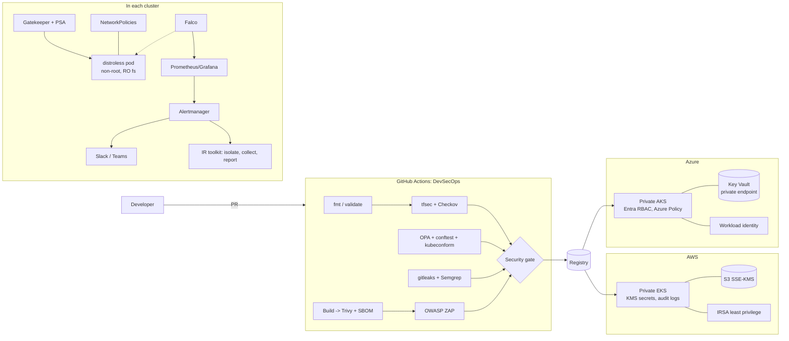
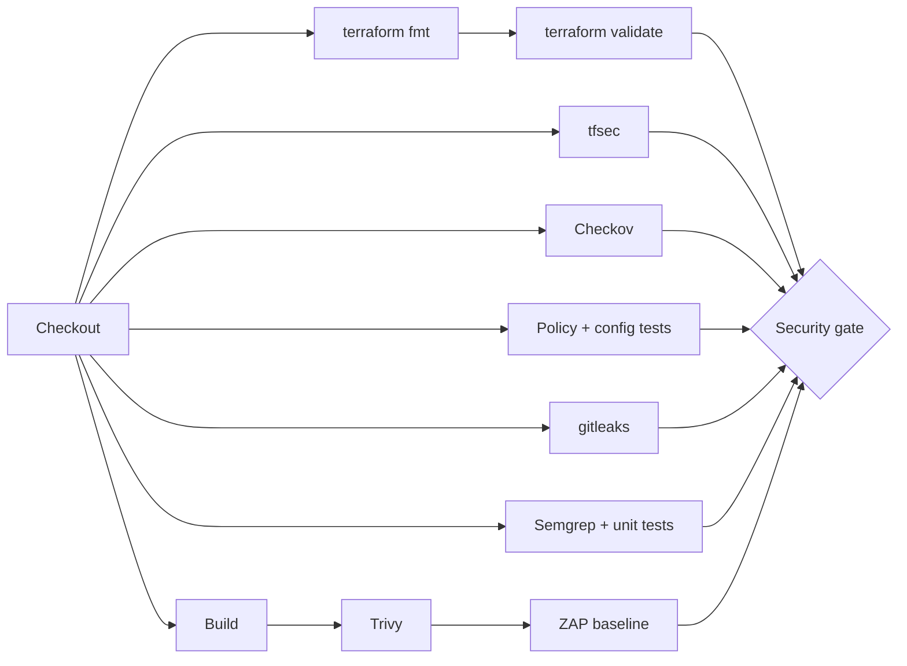

<div align="center">

# cloud-security-blueprint

**An enterprise-style cloud security reference: AWS + Azure infrastructure as code, hardened Kubernetes, policy as code,
a DevSecOps pipeline, runtime threat detection, security monitoring, incident-response automation and compliance mapping.**

[](https://github.com/ahmedlab8/cloud-security-blueprint/actions/workflows/devsecops.yml)


</div>

---

## Table of contents
- [Overview](#overview)
- [Architecture](#architecture)
- [What's inside](#whats-inside)
- [Quickstart](#quickstart)
- [DevSecOps pipeline](#devsecops-pipeline)
- [Security scan results](#security-scan-results)
- [Kubernetes and policy as code](#kubernetes-and-policy-as-code)
- [Runtime detection, monitoring and incident response](#runtime-detection-monitoring-and-incident-response)
- [Compliance](#compliance)
- [Documentation](#documentation)
- [Screenshots](#screenshots)
- [Repository structure](#repository-structure)

## Overview

This repository shows how a senior cloud security / DevSecOps engineer would secure a
containerised workload end to end, across **two clouds**, with each control **codified,
tested and scanned**:

| Layer | Controls |
|---|---|
| **Infrastructure** | Private EKS/AKS control planes, least-privilege workload identity (IRSA / Entra), customer-managed KMS / HSM keys, encrypted and private storage, default-deny networks, full audit logging |
| **Supply chain** | Distroless non-root image, pinned dependencies, SBOM, SHA-pinned GitHub Actions, IaC/SCA/image/secret/SAST/DAST gates |
| **Admission** | Pod Security Standards `restricted` plus Gatekeeper: no root, no privileged, no `:latest`, limits required, no public load balancers |
| **Runtime** | Read-only filesystems, zero-trust NetworkPolicies, Falco detections for shells, privilege escalation, container escape, crypto-mining and credential access |
| **Operations** | Prometheus alerts and Grafana dashboards, Slack/Teams routing, automated containment and evidence collection, incident reports |
| **Governance** | STRIDE threat model, design decisions, and a control matrix mapped to NIST 800-53, CIS, SOC 2 and ISO 27001 |

> **Status:** everything has been formatted, validated, unit-tested and scanned (see
> [Security scan results](#security-scan-results)), but it has **not been deployed to a real
> cloud account**. The Terraform is written to be deployable. Review costs and sizing before
> you apply it.

## Architecture



More diagrams (runtime layers, IR sequence): [docs/architecture.md](docs/architecture.md).

## What's inside

| Requirement | Implementation |
|---|---|
| Terraform security (AWS) | [`terraform/aws`](terraform/aws): VPC, private/public subnets, NAT, flow logs, 4 rotating KMS CMKs, hardened S3 module, least-privilege IAM and IRSA, private EKS with secrets encryption, IMDSv2 nodes |
| Terraform security (Azure) | [`terraform/azure`](terraform/azure): RG, VNet, NSGs, NAT, Key Vault (RBAC, purge protection, private endpoint), HSM CMK + disk encryption set, managed identities + workload identity, private AKS |
| IaC scanning | tfsec + Checkov in CI with [real reports](security-tools/reports) and a [remediation guide](docs/remediation-guide.md) |
| Kubernetes security | [`kubernetes/`](kubernetes): Deployment, Service, NetworkPolicies, Role/RoleBinding, PSS, quotas, Secrets Store CSI |
| OPA/Gatekeeper | [`policies/opa`](policies/opa): 5 ConstraintTemplates, Constraints, 20 unit tests, conftest in CI |
| Container security | [`app/Dockerfile`](app/Dockerfile) (distroless, non-root) plus Trivy image/fs/config scans and SBOM |
| DevSecOps pipeline | [`.github/workflows/devsecops.yml`](.github/workflows/devsecops.yml) (copy in [`cicd/`](cicd)) |
| Monitoring | [`monitoring/`](monitoring): Prometheus config + 10 alert rules (with promtool tests), Alertmanager, 4 Grafana dashboards |
| Runtime detection | [`security-tools/falco`](security-tools/falco): Helm values + 9 MITRE-tagged rules (validated with Falco 0.45.1) |
| Incident response | [`incident-response/`](incident-response): Python toolkit + Bash scripts, `--dry-run`, 14 tests |
| Compliance | [`policies/compliance`](policies/compliance): 26 controls mapped to NIST 800-53 r5 / CIS / SOC 2 / ISO 27001:2022 |

## Quickstart

```bash
git clone https://github.com/ahmedlab8/cloud-security-blueprint.git && cd cloud-security-blueprint

# 1. Offline validation: terraform fmt/validate, OPA tests, conftest, kubeconform, ruff, shellcheck, pytest, promtool
make validate

# 2. Security scans: tfsec, Checkov, Semgrep, gitleaks
make all

# 3. Build and scan the sample image, then run it hardened
make image
docker run --rm --read-only --tmpfs /tmp --cap-drop ALL --security-opt no-new-privileges \
  -e DEMO_PASSWORD=local-only -p 8080:8080 secure-app:local

# 4. Incident-response drill (no cluster needed)
./incident-response/ir_toolkit.py respond --falco-event incident-response/templates/falco-event.example.json --dry-run
```

To deploy to AWS or Azure, follow [docs/deployment-guide.md](docs/deployment-guide.md).

## DevSecOps pipeline



| Gate | Fails on |
|---|---|
| terraform fmt / validate | any error (AWS + Azure matrix) |
| tfsec | HIGH or CRITICAL |
| Checkov (Terraform, K8s, Dockerfile, Actions) | any failed check (accepted risks need an inline skip with a reason) |
| Trivy | fixable CRITICAL image CVE; HIGH+ dependency CVE or misconfiguration |
| gitleaks | any secret in the full git history |
| Semgrep | ERROR-severity finding |
| OWASP ZAP baseline | any rule marked `FAIL` in [`rules.tsv`](security-tools/zap/rules.tsv) |
| OPA / conftest | any policy violation, or the insecure fixture being *accepted* |

Hardening: actions pinned to commit SHAs, read-only `GITHUB_TOKEN`, `persist-credentials: false`,
pinned tool versions, a weekly scheduled re-scan, and Dependabot. Details: [cicd/README.md](cicd/README.md).

Code scanning: a report-only `code-scanning` job uploads tfsec and Trivy config results as SARIF to the
repository's **Security → Code scanning** tab at the same HIGH/CRITICAL threshold as the gate (public repos only; it skips on private repos and fork PRs).

## Security scan results

From real runs on 2026-10-20 ([full reports](security-tools/reports/README.md)):

| Scanner | Hardened blueprint | Insecure training example |
|---|---|---|
| tfsec | **0 findings** (AWS 53 passed / Azure 16 passed, 2 justified ignores) | 27 findings (4 CRITICAL, 12 HIGH) |
| Checkov | **0 failed** of 706 checks (Terraform 290, K8s 124, Dockerfile 36, Actions 256) | 35 failed |
| Trivy image | **0 CRITICAL**, 26 HIGH, none with a fix available (distroless Debian 13) | base `python:3.11-bookworm`: 21 CRITICAL / 586 HIGH |
| Trivy SCA / config | 0 / 0 | - |
| gitleaks / Semgrep | 0 / 0 | - |
| OWASP ZAP baseline | 0 FAIL, 0 WARN, 66 PASS | - |

## Kubernetes and policy as code

```bash
kubectl -n secure-app run bad --image=nginx:latest
# Error from server (Forbidden): admission webhook "validation.gatekeeper.sh" denied the request:
# [disallow-latest-tag] container <bad> image <nginx:latest> must use an explicit, non-latest tag or a digest
# [block-root-containers] container <bad> must set runAsNonRoot=true ...
```
*(Example of the messages the policies produce. The same Rego gives this output under conftest in CI.)*

## Runtime detection, monitoring and incident response

- **Falco:** shell in container, privilege escalation (sudo/su, setuid bit, `setuid(0)`), container escape tooling, crypto miners and mining-pool ports, sensitive file reads, SA token access.
- **Prometheus/Grafana:** Security Alerts, Failed Logins, Container Restarts, and CPU/Memory dashboards. Alerts route to Slack/Teams.
- **IR toolkit:** `respond` quarantines the pod with a deny-all NetworkPolicy, keeps it for forensics, captures logs and artifacts with a SHA-256 manifest, notifies Slack/Teams, and writes a markdown report.

## Compliance

[`policies/compliance/compliance-matrix.md`](policies/compliance/compliance-matrix.md) maps
26 repo controls to **NIST SP 800-53 r5**, **CIS Benchmarks** (AWS, Azure, Kubernetes, EKS/AKS,
Docker), **SOC 2 TSC**, and **ISO/IEC 27001:2022 Annex A**, with reverse indexes per framework.
The source CSV is machine-readable for GRC tooling.

## Documentation

| Doc | |
|---|---|
| [Architecture](docs/architecture.md) | Diagrams and repo map |
| [Deployment guide](docs/deployment-guide.md) | Step-by-step AWS and Azure deployment and verification |
| [Security design decisions](docs/security-design-decisions.md) | ADRs with trade-offs and gate thresholds |
| [Threat model](docs/threat-model.md) | STRIDE analysis, abuse cases, roadmap |
| [Remediation guide](docs/remediation-guide.md) | From findings to fixes, plus accepted risks |

## Screenshots

> **Placeholders.** These will be captured after a live deployment. See [docs/screenshots/README.md](docs/screenshots/README.md).

| Pipeline | Gatekeeper | Falco | Grafana |
|---|---|---|---|
| _placeholder: `pipeline-green.png`_ | _placeholder: `gatekeeper-deny.png`_ | _placeholder: `falco-shell-alert.png`_ | _placeholder: `grafana-security-alerts.png`_ |

## Repository structure

```
cloud-security-blueprint/
├── terraform/
│   ├── aws/                 # VPC, KMS, S3 module, IAM/IRSA, EKS
│   └── azure/               # RG, VNet/NSG, Key Vault, identities, AKS
├── kubernetes/
│   ├── secure-cluster/      # Namespace, SA, Deployment, Service, RBAC, quotas, CSI secrets
│   ├── network-policies/    # default deny + explicit allows + quarantine
│   └── pod-security/        # PSS tiers + admission configuration
├── policies/
│   ├── opa/                 # Gatekeeper Rego, templates, constraints, tests, conftest
│   └── compliance/          # NIST / CIS / SOC 2 / ISO 27001 mapping
├── cicd/                    # pipeline reference + docs
├── security-tools/          # Falco, ZAP rules, real scan reports, insecure example
├── monitoring/              # Prometheus, Alertmanager, Grafana dashboards
├── incident-response/       # ir_toolkit.py + bash scripts + tests
├── app/                     # sample Flask service + distroless Dockerfile
├── docs/                    # architecture, deployment, design decisions, threat model
├── .github/                 # workflow, CODEOWNERS, Dependabot, PR template
├── Makefile                 # local gates
├── SECURITY.md · CONTRIBUTING.md · LICENSE
└── README.md
```

## License

[MIT](LICENSE) © 2026 Ahmed ([@ahmedlab8](https://github.com/ahmedlab8))
