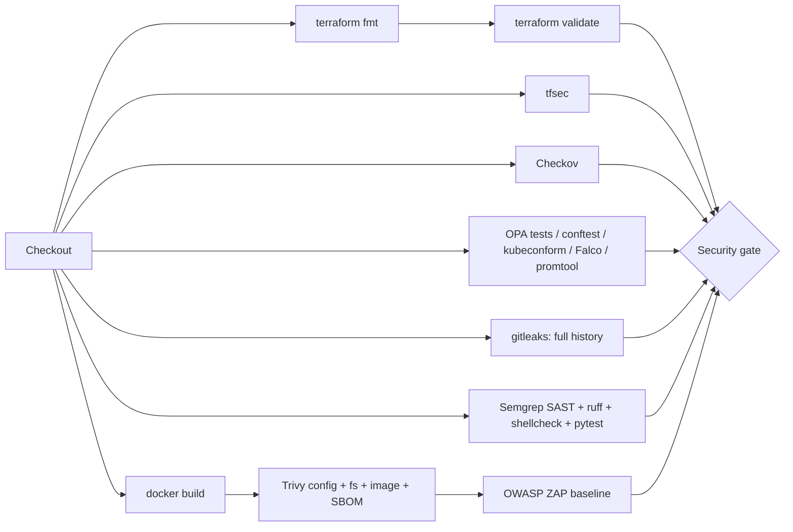

# CI/CD: DevSecOps pipeline

The live workflow is `.github/workflows/devsecops.yml`. `cicd/devsecops.yml` is a reference
copy so the pipeline is easy to find in the repo structure. CI does **not** check that the two
match, so if you change one, copy it over the other.

| Stage | Job | Tool | Fails the build on |
|---|---|---|---|
| Checkout | all | `actions/checkout` (SHA-pinned, `persist-credentials: false`) | - |
| Terraform fmt | `terraform` (aws, azure matrix) | `terraform fmt -check -recursive` | unformatted code |
| Terraform validate | `terraform` | `terraform init -backend=false` + `validate` | invalid config |
| tfsec | `tfsec` | tfsec 1.28.11 | HIGH / CRITICAL |
| Checkov | `checkov` | Checkov 3.3.30 (Terraform, K8s, Dockerfile, GitHub Actions) | any failed check |
| Policy | `policy-and-config` | `opa test`, conftest, kubeconform, Falco `-V`, promtool, amtool | any failure, or the insecure fixture being accepted |
| Secret scanning | `secret-scan` | gitleaks 8.30.1 over full git history | any leak |
| SAST | `sast` | Semgrep (python, flask, dockerfile, github-actions, secrets) | ERROR severity |
| Container | `container` | Trivy config, fs (SCA), image + CycloneDX SBOM | HIGH+ misconfig or dependency CVE; **fixable CRITICAL** image CVE |
| DAST | `dast` | OWASP ZAP baseline against the running container | any rule marked `FAIL` in `security-tools/zap/rules.tsv` |
| Gate | `security-gate` | `needs` aggregation and step summary | any upstream stage not `success` |

Triggers: push to `main`, pull requests, manual dispatch, and a weekly schedule (re-scan for new CVEs).
Make **Security gate** a required status check in branch protection.
