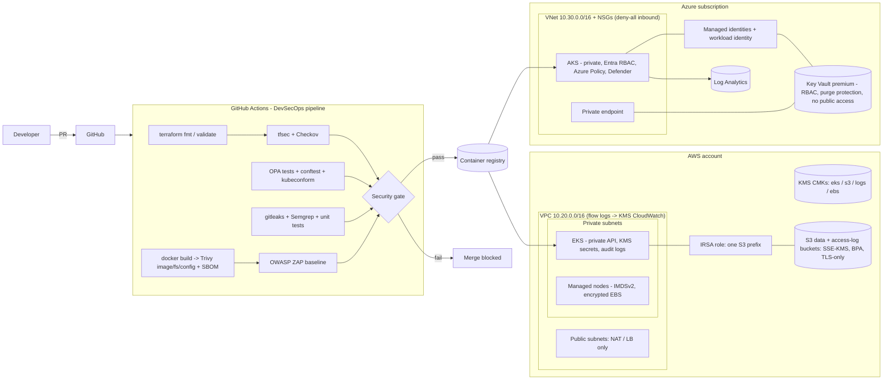
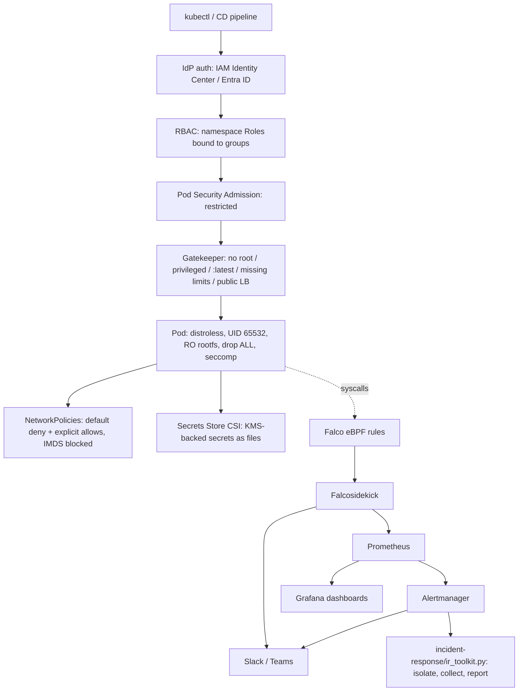
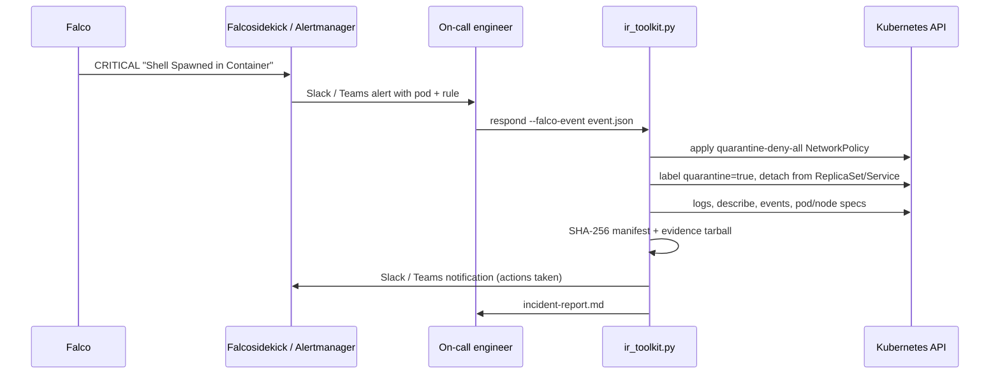

# Architecture

## High-level view

## Kubernetes runtime layers

## Incident-response flow

## Repository map

| Path | Purpose |
|---|---|
| `terraform/aws` | VPC, subnets, NAT, flow logs, KMS, S3 module, IAM (cluster, node, IRSA), EKS |
| `terraform/azure` | RG, VNet, NSGs, NAT, Key Vault + private endpoint, managed identities, AKS, Log Analytics |
| `kubernetes/secure-cluster` | Namespace (PSS), ServiceAccount, Deployment, Service, Role/RoleBinding, quotas, SecretProviderClass |
| `kubernetes/network-policies` | Default deny, DNS, ingress controller, Prometheus, HTTPS egress, quarantine |
| `kubernetes/pod-security` | PSS namespace tiers and the PSA admission configuration |
| `policies/opa` | Gatekeeper Rego (tested), generated ConstraintTemplates, Constraints, conftest wrapper |
| `policies/compliance` | Control mapping CSV and generated matrix (NIST / CIS / SOC 2 / ISO) |
| `app/` | Sample Flask service, distroless Dockerfile, tests |
| `security-tools/` | Falco, ZAP rules, scan reports, insecure training example |
| `monitoring/` | Prometheus config + alert rules (with tests), Alertmanager, Grafana dashboards |
| `incident-response/` | Python toolkit + Bash scripts with dry-run and tests |
| `.github/workflows` (copy in `cicd/`) | DevSecOps pipeline |
