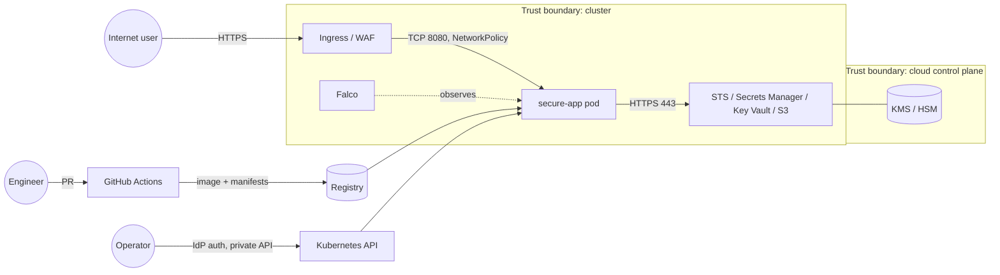

# Threat model (STRIDE)

**Scope:** the secure-app workload on EKS/AKS, its cloud dependencies (KMS/Key Vault, S3,
Secrets Manager), the CI/CD pipeline, and the operators.
**Method:** STRIDE per element. Likelihood (L) and impact (I) are each scored 1-3, and residual
risk is scored after controls.

## Data flow diagram

## STRIDE analysis

| # | Element | STRIDE | Threat | L | I | Controls in this repo | Residual |
|---|---|---|---|---|---|---|---|
| T1 | Kubernetes API | **S**poofing | Stolen kubeconfig or static token used from the internet | 2 | 3 | Private endpoint (SDD-01), IdP-only auth, AKS local accounts disabled, EKS access entries | Low |
| T2 | Workload identity | **S**poofing | Pod steals node IAM credentials via IMDS | 2 | 3 | IMDSv2 with hop limit 1, NetworkPolicy blocks 169.254.169.254, IRSA / workload identity | Low |
| T3 | Login endpoint | **S**poofing | Credential stuffing / brute force | 3 | 2 | Failed-login metrics, `HighFailedLoginRate` alert, Grafana dashboard, constant-time compare | Medium (add rate limiting / WAF) |
| T4 | Container image | **T**ampering | Malicious or vulnerable image deployed | 2 | 3 | Trivy gate, SBOM, digest pinning at deploy, `:latest` blocked, SHA-pinned actions | Low-Medium (add image signing with cosign + admission verification) |
| T5 | IaC / manifests | **T**ampering | Insecure change merged | 2 | 3 | tfsec, Checkov, conftest, CODEOWNERS review, security gate | Low |
| T6 | Container filesystem | **T**ampering | Attacker drops tooling or persistence | 2 | 2 | Read-only rootfs, distroless, Falco setuid/escape rules | Low |
| T7 | Admin actions | **R**epudiation | Change with no audit trail | 2 | 2 | EKS audit logs, AKS kube-audit-admin, Key Vault audit, CloudWatch/Log Analytics 365-day retention, Git history | Low |
| T8 | IR evidence | **R**epudiation | Evidence altered after collection | 1 | 2 | SHA-256 manifest, 0600/0700 permissions, tarball hash in the report | Low |
| T9 | S3 data | **I**nformation disclosure | Public bucket / unencrypted data | 2 | 3 | Block Public Access, SSE-KMS (CMK), TLS-only policy, access logs | Low |
| T10 | Secrets | **I**nformation disclosure | Secrets in Git, image, or environment variables | 3 | 3 | gitleaks (full history), CSI file mounts, Secrets Manager / Key Vault, `*_FILE` pattern | Low |
| T11 | Pod network | **I**nformation disclosure | Lateral movement and exfiltration | 2 | 3 | Default-deny NetworkPolicies, egress limited to 443, quarantine policy | Medium (add FQDN egress filtering) |
| T12 | App responses | **I**nformation disclosure | Banner / stack-trace leakage | 2 | 1 | ZAP baseline gate, security headers, server banner hidden | Low |
| T13 | Cluster resources | **D**enial of service | Resource exhaustion / crypto-mining | 3 | 2 | Limits enforced by Gatekeeper, LimitRange, ResourceQuota, CPU alerts, Falco mining rules | Low |
| T14 | Workload | **D**enial of service | Node or zone failure | 2 | 2 | 3 replicas, topology spread, PDB, multi-AZ node groups | Low |
| T15 | Pod | **E**levation of privilege | Container escape to node | 2 | 3 | PSS restricted, Gatekeeper (no root or privileged, no host namespaces), drop ALL, seccomp, Falco escape rules | Low |
| T16 | RBAC | **E**levation of privilege | Over-broad roles / wildcard verbs | 2 | 3 | Namespace Roles, no wildcards, group bindings, Checkov K8s RBAC checks | Low |
| T17 | CI/CD | **E**levation of privilege | Compromised third-party action or token | 2 | 3 | SHA pinning, read-only `GITHUB_TOKEN`, `persist-credentials: false`, no cloud credentials in CI (validate only) | Low-Medium (add OIDC-federated deploy with environment approvals) |

## Abuse cases and detections

| Abuse case | ATT&CK | Detection | Response |
|---|---|---|---|
| RCE in the app leads to a shell | T1059 | Falco `CSB Shell Spawned in Container` | `ir_toolkit.py respond` |
| Container breakout via nsenter or setuid | T1611, T1548 | Falco escape and setuid rules | Isolate pod, cordon node |
| Crypto-miner dropped | T1496 | Falco miner process and pool-port rules, `ContainerCPUNearLimit` | Isolate, rebuild image |
| Credential theft from the filesystem | T1552 | Falco `Sensitive File Read`, SA token rule | Isolate, rotate credentials |
| Brute force on /login | T1110 | `HighFailedLoginRate` | Block at WAF, review accounts |

## Open items (roadmap)

1. Image signing (cosign / Notation) with admission verification (Gatekeeper external data or Kyverno).
2. FQDN-based egress control (Cilium / Calico Enterprise / Azure Firewall).
3. Rate limiting at the ingress / WAF for `/login`.
4. OIDC-federated `terraform plan` in CI with environment protection rules.
5. Runtime drift detection (`kubectl diff` in CI against the live cluster).
